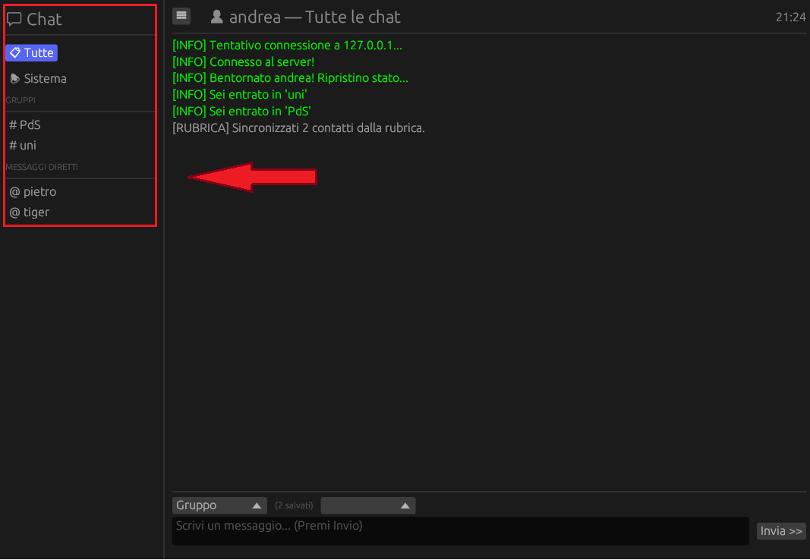
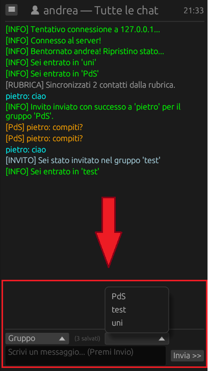
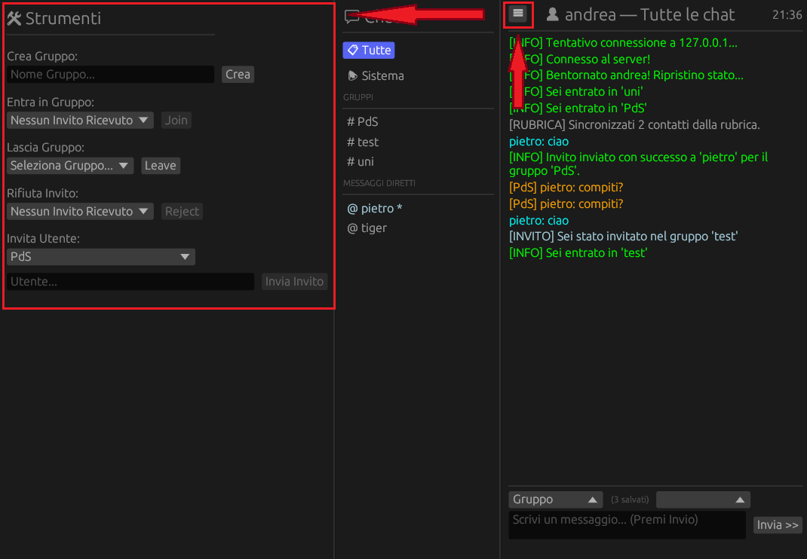

# Manuale Utente - Ruggine

Benvenuto in **Ruggine**, un'applicazione client-server scritta in Rust che supporta comunicazioni testuali in tempo reale, creazione di gruppi, messaggistica privata (DM) e persistenza dei dati.

## 1. Panoramica dell'Architettura

L'applicazione si divide in tre componenti principali eseguibili allínterno della cartella `ruggine/src/bin`:

* **Server (`server.rs`)**: Il cuore centrale che smista i messaggi, gestisce l'autenticazione e salva i dati in modo persistente.
* **Client CLI (`client.rs`)**: Un client da terminale leggero e rapido, comandato tramite comandi testuali.
* **Client GUI (`gui_client.rs`)**: Un client grafico (basato su `egui`) con gestione delle chat e menú interattivi.

---

## 2. Avvio e Gestione del Server

Il server deve essere sempre in esecuzione per permettere ai client di connettersi. Ascolta di default sulla porta `8190`.

### Metodo A: Utilizzo tramite Docker (Consigliato)

L'applicazione è pronta per la produzione tramite un'architettura dockerizzata. Il processo di build è ottimizzato grazie all'uso di `cargo-chef` per il caching delle dipendenze.

Per avviare il server in background usando il file `docker-compose.yml` fornito:

```bash
docker-compose up -d

```

> 
> **Nota Sicurezza:** Nel container Docker, l'applicazione viene eseguita in modo sicuro utilizzando l'utente non privilegiato `ruggine_user`. I volumi di sistema si occuperanno di creare automaticamente le cartelle `./data` e `./logs` nel tuo sistema host, per non perdere i dati se il container venisse riavviato.
> 
> 

### Metodo B: Avvio Locale (Per Sviluppatori)

Se non utilizzi Docker e hai l'ambiente Rust configurato:

```bash
cargo run --bin server

```

---

## 3. Utilizzo del Client a Riga di Comando (CLI)

Per chi preferisce il terminale, il client CLI offre un controllo totale tramite comandi.

**Avvio:**

```bash
cargo run --bin client

```

**Fase di Accesso:**

1. **IP Server**: Inserisci l'indirizzo IP (se premi `Invio` a vuoto, si connetterà automaticamente in locale a `127.0.0.1:8190`).
2. **Username & Password**: Inserisci le tue credenziali. Se l'utente non esiste, verrà **registrato automaticamente** al primo accesso.

**Comandi Disponibili:**

* `/create <nome_gruppo>` : Crea un nuovo gruppo.
* `/invite <nome_gruppo> <utente>` : Invia un invito per un gruppo di cui fai parte a un altro utente.
* `/join <nome_gruppo>` : Accetta un invito ricevuto ed entra nel gruppo.
* `/leave <nome_gruppo>` : Esci da un gruppo di cui fai parte.
* `/reject <nome_gruppo>` : Rifiuta un invito ad unirsi ad un gruppo.
* `/msg <nome_gruppo> <messaggio...>` : Invia un messaggio a tutti i membri del gruppo.
* `/dm <utente> <messaggio...>` : Invia un messaggio privato diretto a un utente.
* `exit` : Disconnette il client e chiude l'app.

---

## 4. Utilizzo del Client Grafico (GUI)

L'interfaccia grafica offre l'esperienza più user-friendly per gli utenti finali.

**Avvio:**

```bash
cargo run --bin gui_client

```

### Interfaccia e Navigazione

* **Schermata di Login:** Inserisci IP Server, Username e Password e clicca su "Entra nella Chat".


* **Pannello Laterale Sinistro (Chat):** Mostra la lista delle tue conversazioni attive.


    * **Tutte / Sistema:** Visualizza tutti i messaggi o solo le notifiche di sistema.
* **Simboli speciali:** Un asterisco (`*`) accanto al nome indica la presenza di **messaggi non letti**.


**Pannello Centrale:**
* Mostra la cronologia messaggi.
* In basso, troverai la barra dei messaggi. Utilizza il menu a tendina a sinistra per **cambiare modalità** da *"Gruppo"* a *"Privato (DM)"* e quello di destra per **selezionare** a chi vuoi inviare il messaggio.




**Pannello Strumenti Destro (Tasto ☰):**
* Cliccando l'icona in alto a sinistra, si aprirà un pannello per gestire la creazione di gruppi, la gestione degli inviti (Join/Reject/Invite) e la possibilità di lasciare gruppi esistenti tramite pratiche interfacce a comparsa.



---

## 5. Dati e Struttura dei File

L'applicazione salva e storicizza i dati. Il tuo albero delle directory riflette questa funzionalità:

**Cartella `data/`**
* `server_data.json`: Il "database" del server. Contiene le password (criptate con hash), la composizione dei gruppi, e le rubriche di chi ha messaggiato con chi e gli inviti non ancora accettati.
* `client_history_<nomeutente>.json`: File generati dal client grafico. Salvano localmente i contatti noti e i gruppi dell'utente per ripristinare la UI all'avvio successivo.


**Cartella `logs/`**
* `dump.log`: Sia il server che i client (GUI e CLI) scrivono in questo file dati telemetrici ogni pochi minuti, in particolare il consumo di CPU dei processi.


---